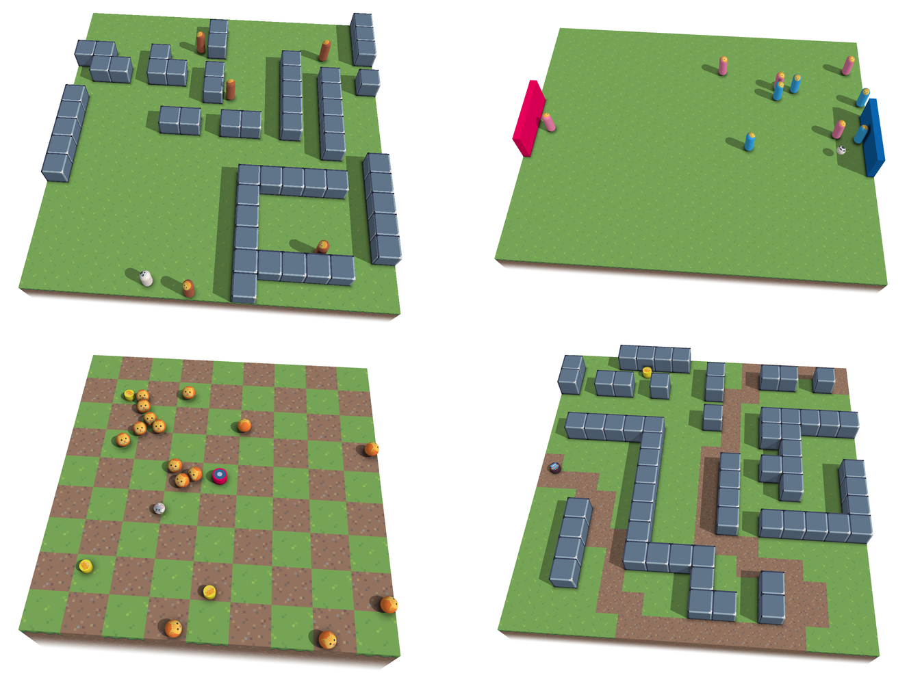

# BeyondTheGrid

This is the code for the paper https://arxiv.org/abs/2609.24025,
to be presented at SIGGRAP Asia 2026.

<p align="center"></p>

To run, install the .NET 10 SDK and run this command from the repository root:

```sh
dotnet run
```

Edit `games.lisp` in the repository root to choose which games to run. Game definitions
are in `games/`, and graphics assets are in `resources/`. Building copies these files
into `bin/` automatically; `bin/` and `obj/` are generated locally and excluded from Git.

The project is `BeyondTheGrid.csproj`, and the Windows executable is `bin/BeyondTheGrid.exe`.
Only the 15 emoji images used by the included games are bundled in `resources/emoji/`.
